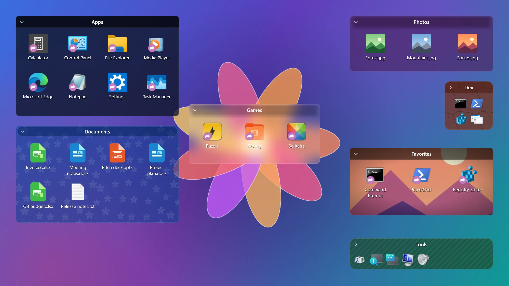
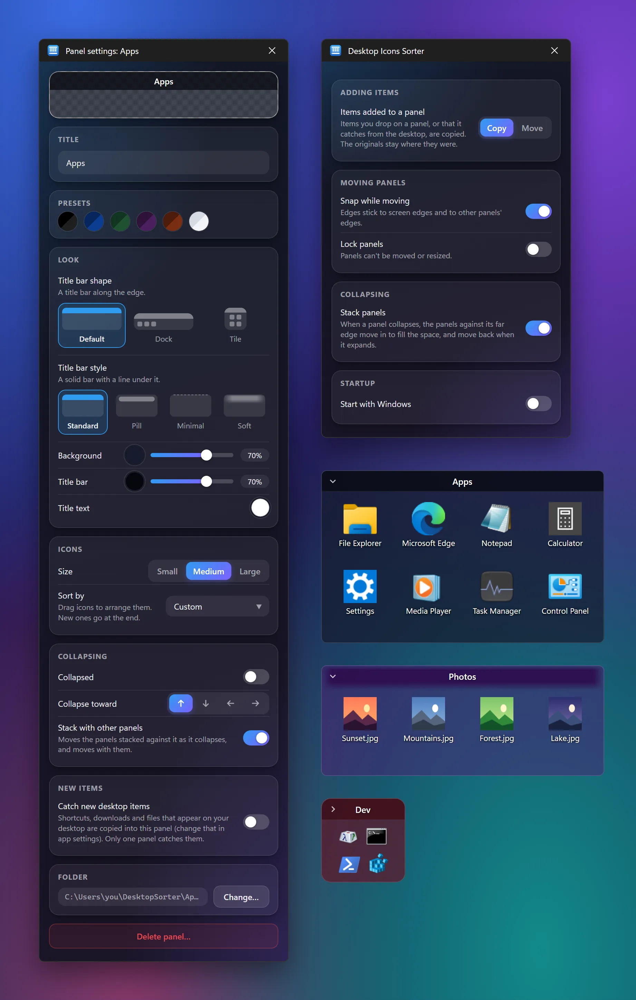

# Desktop Icons Sorter

Rectangular, customizable panels on the Windows desktop for sorting your icons. It works like Stardock Fences: drop shortcuts into a panel to group them, then collapse the panel when you want a clean desktop.



It's a small native app (Rust, Win32 and Direct2D): one process of about 16 MB with four panels, and a single exe under 1 MB.

Free and open source under the [MIT License](LICENSE).

## Features

- **Panels that live on the desktop.** They sit behind normal windows, stay out of the taskbar and Alt+Tab, and stay visible on "Show desktop" (Win+D).
- **Folder-backed.** Each panel shows a real folder (`%USERPROFILE%\DesktopSorter\<panel>` by default). Dropping a desktop icon onto a panel copies it into that folder, or moves it there so it leaves the cluttered desktop: choose Copy (the default) or Move in app settings. Icons dragged from one panel to another always move. The grouping survives restarts and Windows rearranging your icons.
- **Customizable per panel**, in a settings window with one-click controls (picture tiles for the title bar shape and style, arrow buttons for the collapse direction, toggle switches) that follows the Windows light or dark theme:
  - title (double-click it to rename)
  - background color and transparency
  - title bar color, transparency and text color
  - title bar shape: default, dock (a collapsed panel shows a row of its apps you can click to open) or tile (a collapsed panel is a square with four of its apps, at the start, middle or end of its edge)
  - title bar style, with any shape: standard, pill (a rounded capsule), minimal (just the title, no bar, expanded or collapsed; the collapse arrow shows when you point at the panel, and a collapsed panel always shows its expand arrow) or soft (the bar fades out at its ends and blends into the panel instead of hard edges)
  - color presets
  - icon size (small, medium, large) and sort order (custom, name, type, date modified)
- **Arrange icons your way.** Drag an icon to any spot in its panel, including empty ones, and it stays there, gaps and all. Drop it on another icon and that icon and the ones right after it slide along to the next gap, like a phone's home screen. Custom order is the default; new items go after the last icon, and an item dropped in from elsewhere lands where you drop it. If a panel gets too narrow for an icon's column, the icon moves to the next free spot until the panel is wide enough again. Picking Name, Type or Date sorts the panel instead, and dragging an icon switches back to custom order.
- **Catch new desktop items.** Turn on "Catch new desktop items" in a panel's settings and new shortcuts, downloads and files that appear on your desktop are copied (or moved, as set in app settings) into that panel. One panel catches at a time. It waits for a download to finish, and leaves alone renamed desktop items, empty new files and folders (probably still being named), and items you move to the desktop from a panel. It watches your own Desktop folder only, so shortcuts an installer puts on the shared Public Desktop (for all users) aren't caught.
- **Collapsible.** Click the chevron or double-click an empty part of the title bar to roll the panel up to its title bar. In panel settings, choose the edge it collapses toward: up, down, left or right. The title bar sits on that edge, so a bottom bar suits panels near the taskbar and a side bar suits panels along a screen edge.
- **Stackable.** Put panels against each other, say one under another, and collapsing the top one moves the ones below it up to fill the space; expanding it moves them back down. It works the same way for panels that collapse down, left or right. Turn it off for every panel in app settings, or leave one panel out of it in its panel settings.
- **Move and resize** by dragging the title bar or the edges. While you drag, a panel's edges snap to screen edges and to other panels' edges, so panels line up and sit flush against each other; keep dragging to pull away. Turn snapping off in app settings, and lock all panels from the tray.
- **App settings** (tray menu > Settings…, or App settings… in a panel's title bar menu): whether panels copy or move the items added to them, snapping, stacking, locking panels and starting with Windows.
- **Starts with Windows** after a fresh install (turn it off in app settings or the tray menu). The portable exe doesn't, since it isn't installed anywhere.
- **Item actions:**
  - double-click to open
  - drag out to Explorer, the desktop or another panel
  - right-click for Open file location, Rename (or F2), Move to Desktop or another panel, and Move to Recycle Bin
- **Tray menu:** New panel, Show/Hide panels, Lock panels, Start with Windows, Settings…, Open config folder, Quit.
- **Safe deletes.** Deleting a panel asks whether to move its items back to the Desktop. Files are never deleted.

<p align="center">
  
</p>

## Getting started

Requirements: Windows 10 or 11, [Rust](https://rustup.rs) (stable, MSVC toolchain) and the Visual Studio C++ build tools with the Windows SDK.

```bash
cargo run            # debug build, with a console for log output
cargo run --release  # optimized build, no console
```

Build the installer and the portable exe into `dist/` (needs [NSIS](https://nsis.sourceforge.io)):

```bash
cargo build --release
makensis -DVERSION=0.2.0 -DOUTFILE=..\dist\desktop-icons-sorter-0.2.0-setup.exe installer\installer.nsi
```

The release exe (`target\release\desktop-icons-sorter.exe`) is a single file that runs from anywhere, so it's also the portable build. The installer puts it in `%LOCALAPPDATA%\Programs\Desktop Icons Sorter`, adds a Start menu shortcut and starts it with Windows. Installing over an Electron build of the app removes that build first and keeps your panels and settings.

The app and installer icon is `build/icon.ico`. It's generated by `build/make-icon.py` (Python + Pillow); edit that script and run `python3 build/make-icon.py` to change it.

## Releasing

1. Bump `version` in `Cargo.toml` and push it to `main`.
2. Tag that commit and push the tag:

   ```bash
   git tag v0.3.0
   git push origin v0.3.0
   ```

The **Release** workflow then builds both executables on Windows and publishes them as a GitHub release. The release notes list every commit subject since the previous tag (version-bump commits are left out), so write commit subjects that make sense to users. Preview them with `node scripts/release-notes.mjs v0.3.0` after tagging locally. It fails if the tag doesn't match the `Cargo.toml` version. The executables aren't code-signed, so Windows SmartScreen will warn on first run.

## Development

| Command                                      | What it does                                |
| -------------------------------------------- | ------------------------------------------- |
| `cargo run`                                  | Debug build with a console for log output   |
| `cargo build --release`                      | Optimized exe in `target\release`            |
| `cargo test`                                 | Unit tests                                  |
| `cargo clippy --all-targets -- -D warnings`  | Lints                                       |
| `cargo fmt`                                  | Format (`cargo fmt --check` to only check)  |

These environment variables are useful for testing with a throwaway profile:

- `DESKTOP_SORTER_USER_DATA`: where `config.json` is stored (the app then also leaves the Start with Windows entry alone)
- `DESKTOP_SORTER_PANELS_DIR`: parent folder for new panels' folders
- `DESKTOP_SORTER_DESKTOP`: the folder treated as the Desktop (Move to Desktop, catching new items)

### Project layout

```
src/
  lib.rs, model.rs ...     Pure logic, unit tested without Win32:
    config.rs              config.json: validation, recovery, debounced atomic saves
    geometry.rs, stack.rs  Resize, snapping, keeping panels on screen; stacking
    grid.rs                The icon grid in custom order (spots, gaps, placing)
    folder.rs              List, sort, move (collision-safe, cross-drive), copy, rename
    catcher.rs             Deciding which new desktop items to catch
    panel_layout.rs        Where everything in a panel goes, and hit testing
    icon_source.rs, overlay.rs   Shortcut and .url icon locations, the shortcut arrow
  main.rs                  Single instance, OLE, the message loop
  app.rs                   The app's state and everything it does
  procs.rs                 Window procedures: input, menus, drag and drop
  panel.rs                 Drawing a panel; moving and resizing it
  settings.rs              The panel settings and app settings windows
  win/                     Win32: desktop layer, Direct2D drawing, shell icons,
                           folder watching, tray, menus, dialogs, rename box
installer/installer.nsi    The NSIS installer
fixtures/                  A config.json written by the Electron app, for tests
```

### How the desktop layer works

Each panel window is made an _owned_ window of `Progman` (the desktop shell window) and kept at the bottom of the z-order. Owned windows always stay above their owner, so panels sit directly on the desktop, below other apps, and stay visible on Win+D. Unlike rendering into the wallpaper `WorkerW` layer, panels still get mouse input. Panels are layered windows drawn with Direct2D in software into a bitmap with per-pixel alpha, so there's no GPU process. If Explorer restarts, its `TaskbarCreated` broadcast tells the app to re-attach the panels and add the tray icon back.

## Notes and limitations

- Items on the shared _Public Desktop_ (`C:\Users\Public\Desktop`) need administrator rights to move. The app tells you when a move fails.
- Renaming a panel does not rename its folder. Use **Panel settings → Folder → Change…** to point a panel at a different folder.
- Panels and the settings windows aren't yet usable with a screen reader or the keyboard alone (beyond Enter, F2, Escape and Ctrl+A in a panel).

## License

MIT — see [LICENSE](LICENSE).
